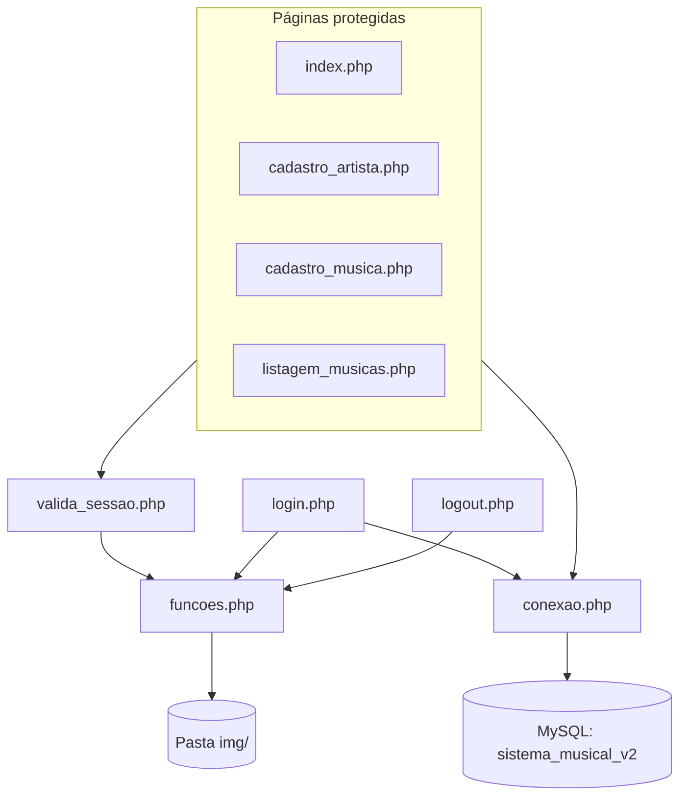
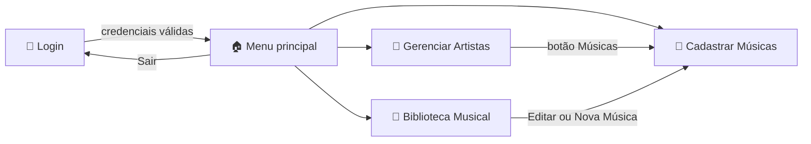
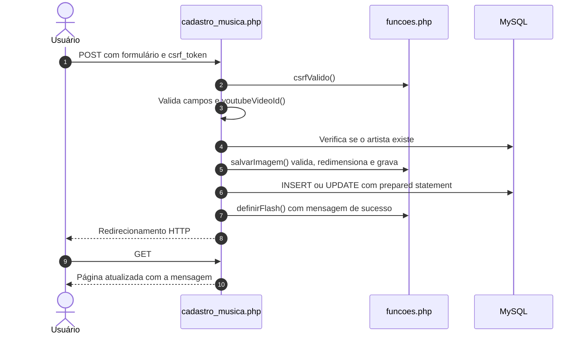
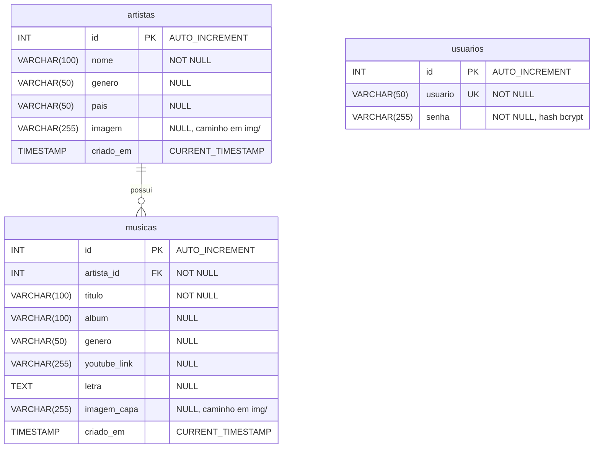

<div align="center">


### ♪ Gerencie artistas, organize músicas e conecte cada faixa ao seu vídeo no YouTube.

Aplicação web em **PHP + MySQL** para cadastro e consulta de um acervo musical,<br/>
com autenticação, upload de imagens com redimensionamento automático e busca com filtros.

<br/>


<br/>


<br/><br/>

<table>
  <tr>
    <td align="center" width="50%"><b>🎤 Artistas</b><br/><sub>Cadastro, edição, exclusão e foto</sub></td>
    <td align="center" width="50%"><b>🎵 Músicas</b><br/><sub>Álbum, gênero, letra, capa e YouTube</sub></td>
  </tr>
  <tr>
    <td align="center"><b>🎼 Biblioteca</b><br/><sub>Busca geral e filtros combinados</sub></td>
    <td align="center"><b>🔒 Segurança</b><br/><sub>Bcrypt, CSRF e prepared statements</sub></td>
  </tr>
</table>

</div>

---

## 📑 Sumário

1. [Sobre o projeto](#-sobre-o-projeto)
2. [Demonstração visual](#-demonstração-visual)
3. [Funcionalidades](#-funcionalidades)
4. [Tecnologias utilizadas](#-tecnologias-utilizadas)
5. [Arquitetura e organização](#-arquitetura-e-organização)
6. [Banco de dados](#-banco-de-dados)
7. [Requisitos](#-requisitos)
8. [Instalação e configuração](#-instalação-e-configuração)
9. [Acesso ao sistema](#-acesso-ao-sistema)
10. [Como utilizar](#-como-utilizar)
11. [Segurança e validações](#-segurança-e-validações)
12. [Regras de negócio](#-regras-de-negócio)
13. [Solução de problemas](#-solução-de-problemas)
14. [Melhorias futuras](#-melhorias-futuras)
15. [Autoria e contexto acadêmico](#-autoria-e-contexto-acadêmico)
16. [Licença](#-licença)
17. [Considerações finais](#-considerações-finais)

---

## 🎯 Sobre o projeto

O **Sistema Musical** é uma aplicação web para gerenciar um catálogo de **artistas** e das **músicas** que pertencem a cada um. O usuário mantém nomes, gêneros e países dos artistas, registra faixas com álbum, letra e capa e associa cada música ao seu vídeo no YouTube.

**Qual problema ele resolve?** Listas de músicas espalhadas em planilhas, anotações e favoritos do navegador são difíceis de consultar e manter consistentes. O sistema centraliza essas informações em um banco de dados relacional que garante que toda música pertença a um artista existente e que nenhum artista seja removido enquanto ainda tiver músicas vinculadas.

**Como funciona a proposta?**

- Após o **login**, o usuário chega a um **menu principal** com contadores de artistas e músicas.
- Em **Gerenciar Artistas**, cadastra e mantém os artistas, cada um com uma foto opcional.
- Em **Cadastrar Músicas**, adiciona faixas vinculadas a um artista, com link obrigatório do YouTube e capa opcional.
- Na **Biblioteca Musical**, consulta o acervo completo por texto, artista e gênero.

**Quem pode utilizá-lo?** Estudantes e professores que avaliam conceitos de desenvolvimento web, além de qualquer pessoa que queira organizar um acervo musical pessoal em ambiente local.

**Importância acadêmica:** o projeto aplica de forma integrada os conteúdos da disciplina: CRUD completo, modelagem relacional com chave estrangeira, autenticação com sessões, upload e processamento de imagens, validação no cliente e no servidor e boas práticas de segurança em PHP.

> [!NOTE]
> O script do banco identifica esta versão como **Fase 2** (`sistema_musical_v2`).

---

## 🖼️ Demonstração visual

> [!NOTE]
> As capturas de tela ainda não foram adicionadas ao repositório. A estrutura abaixo já está pronta para recebê-las.

**Como adicionar as imagens:**

1. Crie a pasta `docs/screenshots/` na raiz do projeto. Use uma pasta separada de `img/`, que é reservada para os uploads do sistema.
2. Salve as capturas com os nomes da tabela abaixo, de preferência em PNG.
3. No código-fonte deste README, remova as marcações `<!--` e `-->` que envolvem a galeria logo abaixo da tabela.

| Tela | Arquivo sugerido | O que capturar |
|---|---|---|
| Login | `docs/screenshots/login.png` | Cartão de login com os campos de usuário e senha |
| Menu principal | `docs/screenshots/menu.png` | Saudação, contadores e os três cartões de navegação |
| Gerenciar artistas | `docs/screenshots/artistas.png` | Formulário e tabela de artistas com fotos |
| Cadastro de músicas | `docs/screenshots/musicas.png` | Formulário completo e tabela filtrada por artista |
| Biblioteca musical | `docs/screenshots/biblioteca.png` | Filtros aplicados e botões "▶ Assistir" |
| Versão mobile | `docs/screenshots/mobile.png` | Qualquer tela em largura reduzida (≤ 768 px) |

<!--
<div align="center">
<table>
  <tr>
    <td align="center"><br/><sub>Login</sub></td>
    <td align="center"><br/><sub>Menu principal</sub></td>
  </tr>
  <tr>
    <td align="center"><br/><sub>Gerenciar artistas</sub></td>
    <td align="center"><br/><sub>Cadastro de músicas</sub></td>
  </tr>
  <tr>
    <td align="center"><br/><sub>Biblioteca musical</sub></td>
    <td align="center"><br/><sub>Versão mobile</sub></td>
  </tr>
</table>
</div>
-->

---

## ✨ Funcionalidades

### 🔐 Autenticação e acesso

| Recurso | Descrição |
|---|---|
| Login com senha criptografada | Senhas armazenadas com hash **bcrypt** e verificadas com `password_verify()`. |
| Proteção de páginas | Todas as telas internas exigem sessão ativa (`valida_sessao.php`). Sem sessão, o usuário volta ao login. |
| Redirecionamento inteligente | Um usuário já autenticado que acesse `login.php` é enviado ao menu. |
| Logout seguro | Encerrado por `POST` com token CSRF: limpa a sessão, expira o cookie e confirma a saída na tela de login. |
| Menu com estatísticas | Exibe saudação personalizada e o total de artistas e de músicas cadastrados. |

### 🎤 Gerenciamento de artistas (`cadastro_artista.php`)

| Recurso | Descrição |
|---|---|
| Cadastro | Nome (obrigatório), gênero musical, país e foto. |
| Edição | Formulário reaproveitado e preenchido com os dados atuais. A foto existente é mantida se nenhuma nova for enviada. |
| Exclusão protegida | Bloqueada quando o artista possui músicas. O botão fica desabilitado e o servidor também verifica. |
| Listagem | Tabela em ordem alfabética com foto, gênero, país e **quantidade de músicas** de cada artista. |
| Atalho para músicas | O botão **🎵 Músicas** abre o cadastro de músicas com o artista já selecionado e a lista filtrada. |

### 🎵 Gerenciamento de músicas (`cadastro_musica.php`)

| Recurso | Descrição |
|---|---|
| Cadastro | Artista e título (obrigatórios), álbum, gênero, link do YouTube (obrigatório), capa e letra. |
| Edição | Permite alterar todos os campos, inclusive **transferir a música para outro artista**. |
| Exclusão | Remove o registro e o arquivo de capa associado, com confirmação prévia. |
| Filtro por artista | O seletor "Exibir músicas de" recarrega a lista automaticamente ao mudar de opção. |
| Pré-requisito | Sem artistas cadastrados, o formulário é substituído por um aviso e um atalho para cadastrar o primeiro artista. |

### 🎼 Listagem e consulta (`listagem_musicas.php`)

| Recurso | Descrição |
|---|---|
| Busca geral | Pesquisa parcial no **título**, no **álbum** e no **nome do artista**. |
| Filtro por artista | Lista suspensa com todos os artistas. |
| Filtro por gênero | Lista montada dinamicamente com os gêneros já usados nas músicas. |
| Filtros combinados | Busca, artista e gênero podem ser usados juntos. O botão **✖ Limpar** remove todos. |
| Ações na lista | Editar (abre o cadastro de músicas) e excluir, mantendo os filtros ativos após a exclusão. |
| Mensagens contextuais | Diferencia "nenhuma música cadastrada" de "nenhum resultado para os filtros". |

### 🖼️ Imagens e capas

| Recurso | Descrição |
|---|---|
| Formatos aceitos | JPG e PNG, identificados pelo **conteúdo real** do arquivo, não pela extensão. |
| Limites | Até **5 MB** e no máximo **20 megapixels**. |
| Redimensionamento automático | Ajuste para caber em **300 × 300 px** sem distorcer a proporção. Imagens menores não são ampliadas. |
| Transparência | Preservada em arquivos PNG. |
| Nomes únicos | Arquivos salvos em `img/` com nome aleatório de 32 caracteres hexadecimais. |
| Limpeza automática | Imagem antiga removida ao substituir. Imagem removida ao excluir o registro. Upload descartado se a gravação no banco falhar. |

### ▶️ Integração com o YouTube

O link informado é validado no servidor, que extrai o **ID de 11 caracteres** do vídeo. Na listagem, o botão **▶ Assistir** abre `https://www.youtube.com/watch?v=<ID>` em nova aba (`target="_blank"` com `rel="noopener noreferrer"`). Não há player incorporado.

| Formato de URL | Aceito |
|---|:---:|
| `https://www.youtube.com/watch?v=XXXXXXXXXXX` | ✅ |
| `https://m.youtube.com/watch?v=XXXXXXXXXXX` | ✅ |
| `https://music.youtube.com/watch?v=XXXXXXXXXXX` | ✅ |
| `https://youtu.be/XXXXXXXXXXX` | ✅ |
| `https://www.youtube.com/shorts/XXXXXXXXXXX` | ✅ |
| `https://www.youtube.com/embed/XXXXXXXXXXX` | ✅ |
| `https://www.youtube-nocookie.com/embed/XXXXXXXXXXX` | ✅ |
| Links de canal ou playlist sem o parâmetro `v` | ❌ |

### 📱 Interface

- Layout responsivo com pontos de quebra em **768 px** e **600 px**: formulários passam a ter uma coluna e as tabelas ganham rolagem horizontal.
- Mensagens de sucesso e erro exibidas uma única vez após cada operação (*flash messages*).
- Confirmação antes de qualquer exclusão.
- Paleta definida por variáveis CSS (`--primary: #2c3e50`, `--blue: #3498db`), também usada nos badges deste README.

---

## 🛠️ Tecnologias utilizadas

| Tecnologia | Papel no projeto | Onde aparece |
|---|---|---|
|  | Lógica de negócio, sessões, validações, upload e acesso ao banco | Todos os arquivos `.php` |
|  | Persistência relacional com InnoDB, chave estrangeira e índices | `bd.sql`, `conexao.php` |
|  | Estrutura das páginas, formulários e validação nativa (`required`, `maxlength`, `type="url"`, `accept`) | Templates nos arquivos PHP |
|  | Estilo, variáveis, grid, flexbox e media queries | `styles.css` |
|  | Uso pontual e **inline**: `confirm()` nas exclusões e envio automático do filtro por artista. Não há arquivos `.js`. | `cadastro_artista.php`, `cadastro_musica.php`, `listagem_musicas.php` |
|  | Versionamento e hospedagem do código | Repositório |

**Recursos do PHP utilizados:** extensão `mysqli` com prepared statements, extensão `GD` para processar imagens, `password_hash()` e `password_verify()`, `random_bytes()`, `hash_equals()`, `filter_input()` e `htmlspecialchars()`.

---

## 🏗️ Arquitetura e organização

O sistema segue uma arquitetura **PHP procedural com páginas autocontidas**. Cada tela processa seus próprios formulários no início do arquivo e depois renderiza o HTML. Funções comuns ficam centralizadas em `funcoes.php`, e todas as gravações seguem o padrão **Post/Redirect/Get**.

### Estrutura de diretórios

```text
.
├── img/                    # Fotos de artistas e capas enviadas (criada automaticamente)
├── bd.sql                  # Script de criação do banco, tabelas e usuário de demonstração
├── cadastro_artista.php    # CRUD de artistas
├── cadastro_musica.php     # CRUD de músicas com filtro por artista
├── conexao.php             # Conexão MySQL e verificação da pasta img/
├── funcoes.php             # Funções compartilhadas (sessão, CSRF, escape, imagens, YouTube)
├── geraSenha.php           # Utilitário de linha de comando para gerar hash bcrypt
├── index.php               # Menu principal com estatísticas
├── listagem_musicas.php    # Biblioteca com busca e filtros
├── login.php               # Autenticação
├── logout.php              # Encerramento da sessão
├── styles.css              # Folha de estilos única e responsiva
├── valida_sessao.php       # Guarda de autenticação das páginas internas
└── README.md               # Esta documentação
```

### Responsabilidade de cada arquivo

| Arquivo | Responsabilidade |
|---|---|
| `index.php` | Menu principal. Exibe saudação, total de artistas e músicas, atalhos para as três áreas e o botão de saída. |
| `login.php` | Formulário de acesso com CSRF, consulta preparada, `password_verify()` e regeneração do ID de sessão após o login. |
| `logout.php` | Aceita apenas `POST` com token válido. Limpa a sessão, expira o cookie e redireciona para `login.php?logout=1`. |
| `cadastro_artista.php` | Cadastra, edita, lista e exclui artistas, com contagem de músicas e bloqueio de exclusão. |
| `cadastro_musica.php` | Cadastra, edita, lista e exclui músicas. Valida o link do YouTube e a existência do artista. |
| `listagem_musicas.php` | Biblioteca com busca geral, filtros por artista e gênero e exclusão que preserva os filtros. |
| `conexao.php` | Verifica a extensão `mysqli`, ativa exceções, conecta com `utf8mb4` e cria `img/` se necessário. |
| `funcoes.php` | Sessão segura, CSRF, escape (`e()`), mensagens flash, redirecionamento, upload, remoção de imagens e extração do ID do YouTube. |
| `valida_sessao.php` | Inicia a sessão e redireciona ao login se `usuario_id` ou `usuario` estiverem ausentes. |
| `geraSenha.php` | Script de terminal que imprime o hash bcrypt da senha definida na variável `$senha`. |
| `bd.sql` | Cria o banco `sistema_musical_v2`, as tabelas `usuarios`, `artistas` e `musicas` e o usuário `admin`. |
| `styles.css` | Estilos organizados por seções: variáveis, formulários, botões, login, menu, tabelas, filtros e responsividade. |
| `img/` | Armazena as imagens processadas. Os caminhos são gravados no banco no formato `img/<nome>.jpg` ou `img/<nome>.png`. |

### Dependências entre arquivos



### Fluxo de navegação



### Ciclo de uma gravação (Post/Redirect/Get)



---

## 🗄️ Banco de dados

| Propriedade | Valor |
|---|---|
| Nome do banco | `sistema_musical_v2` |
| Motor de armazenamento | InnoDB (necessário para chaves estrangeiras) |
| Conjunto de caracteres | `utf8mb4` |
| Collation | `utf8mb4_unicode_ci` |
| Tabelas | `usuarios`, `artistas`, `musicas` |

### Diagrama entidade-relacionamento



> A tabela `usuarios` é independente e serve apenas à autenticação. O relacionamento é **1:N**: um artista pode ter zero ou várias músicas, e cada música pertence a exatamente um artista.

### Tabela `usuarios`

Armazena as contas autorizadas a acessar o sistema.

| Coluna | Tipo | Nulo | Padrão | Restrição | Descrição |
|---|---|:---:|---|---|---|
| `id` | `INT` | Não | `AUTO_INCREMENT` | PK | Identificador do usuário |
| `usuario` | `VARCHAR(50)` | Não | — | `UNIQUE` | Nome de login |
| `senha` | `VARCHAR(255)` | Não | — | — | Hash bcrypt da senha |

### Tabela `artistas`

Cadastro dos artistas do acervo.

| Coluna | Tipo | Nulo | Padrão | Restrição | Descrição |
|---|---|:---:|---|---|---|
| `id` | `INT` | Não | `AUTO_INCREMENT` | PK | Identificador do artista |
| `nome` | `VARCHAR(100)` | Não | — | — | Nome do artista |
| `genero` | `VARCHAR(50)` | Sim | `NULL` | — | Gênero musical |
| `pais` | `VARCHAR(50)` | Sim | `NULL` | — | País de origem |
| `imagem` | `VARCHAR(255)` | Sim | `NULL` | — | Caminho relativo da foto |
| `criado_em` | `TIMESTAMP` | Sim | `CURRENT_TIMESTAMP` | — | Data e hora do cadastro (não exibida na interface) |

### Tabela `musicas`

Faixas vinculadas a um artista.

| Coluna | Tipo | Nulo | Padrão | Restrição | Descrição |
|---|---|:---:|---|---|---|
| `id` | `INT` | Não | `AUTO_INCREMENT` | PK | Identificador da música |
| `artista_id` | `INT` | Não | — | FK → `artistas.id` | Artista dono da música |
| `titulo` | `VARCHAR(100)` | Não | — | Indexada | Título da faixa |
| `album` | `VARCHAR(100)` | Sim | `NULL` | — | Álbum |
| `genero` | `VARCHAR(50)` | Sim | `NULL` | Indexada | Gênero da faixa |
| `youtube_link` | `VARCHAR(255)` | Sim | `NULL` | — | URL do vídeo (obrigatória pela aplicação) |
| `letra` | `TEXT` | Sim | `NULL` | — | Letra completa |
| `imagem_capa` | `VARCHAR(255)` | Sim | `NULL` | — | Caminho relativo da capa |
| `criado_em` | `TIMESTAMP` | Sim | `CURRENT_TIMESTAMP` | — | Data e hora do cadastro (não exibida na interface) |

### Índices e integridade referencial

| Nome | Tabela | Coluna(s) | Tipo | Finalidade |
|---|---|---|---|---|
| `PRIMARY` | todas | `id` | Chave primária | Identificação única de cada registro |
| `usuario` | `usuarios` | `usuario` | `UNIQUE` | Impede logins duplicados |
| `idx_musicas_artista` | `musicas` | `artista_id` | Índice | Agiliza junções e filtros por artista. Também atende à chave estrangeira. |
| `idx_musicas_titulo` | `musicas` | `titulo` | Índice | Apoia ordenação e consultas por título |
| `idx_musicas_genero` | `musicas` | `genero` | Índice | Apoia consultas por gênero |
| `fk_musicas_artistas` | `musicas` | `artista_id` | Chave estrangeira | Garante que toda música aponte para um artista existente |

A restrição `fk_musicas_artistas` define dois comportamentos:

- **`ON DELETE RESTRICT`**: o banco recusa a exclusão de um artista que ainda tenha músicas. A aplicação repete essa verificação e mostra uma mensagem amigável.
- **`ON UPDATE CASCADE`**: se o `id` de um artista mudar, as músicas vinculadas são atualizadas automaticamente.

> [!TIP]
> O script pode ser executado novamente com segurança. Ele usa `CREATE ... IF NOT EXISTS` e `ON DUPLICATE KEY UPDATE`, então **não apaga dados existentes nem redefine a senha** do usuário `admin` se ela tiver sido alterada.

---

## 📋 Requisitos

| Requisito | Necessidade | Motivo |
|---|:---:|---|
| **PHP 8.0 ou superior** | Obrigatório | O código usa `str_starts_with()`, função introduzida no PHP 8.0 |
| Extensão **mysqli** com driver **mysqlnd** | Obrigatório | Conexão com o banco. O método `get_result()` depende do mysqlnd, padrão nas distribuições atuais do PHP |
| Extensão **GD** | Para uploads | Sem ela o sistema funciona, mas recusa imagens com mensagem de erro |
| Extensão **mbstring** | Opcional | Contagem correta de caracteres acentuados. Sem ela, o código usa `strlen()` |
| **MySQL** ou **MariaDB** | Obrigatório | Banco com suporte a InnoDB e `utf8mb4`. O XAMPP traz o MariaDB |
| **Apache** ou servidor embutido do PHP | Obrigatório | Executar as páginas PHP |
| Permissão de escrita na pasta do projeto | Obrigatório | Criação de `img/` e gravação das imagens |
| `upload_max_filesize` e `post_max_size` ≥ 5M | Recomendado | Aproveitar o limite de 5 MB definido pela aplicação |
| Navegador moderno | Obrigatório | Chrome, Firefox, Edge ou Safari em versão atual |
| phpMyAdmin | Opcional | Facilita a importação do `bd.sql` |

---

## 🚀 Instalação e configuração

### 1. Obtenha o projeto

**Opção A, com Git:**

```bash
git clone <URL-DO-REPOSITÓRIO>
```

**Opção B, com ZIP:** no GitHub, clique em **Code → Download ZIP** ou use o arquivo entregue na atividade.

### 2. Extraia e posicione a pasta

Extraia o ZIP e coloque a pasta do projeto no diretório público do servidor. Nos exemplos abaixo, a pasta se chama `sistema-musical`. Substitua pelo nome que você usar.

| Ambiente | Diretório |
|---|---|
| XAMPP (Windows) | `C:\xampp\htdocs\sistema-musical` |
| XAMPP (Linux) | `/opt/lampp/htdocs/sistema-musical` |
| XAMPP (macOS) | `/Applications/XAMPP/htdocs/sistema-musical` |
| Apache (Debian/Ubuntu) | `/var/www/html/sistema-musical` |
| Servidor embutido do PHP | Qualquer pasta |

### 3. Inicie o servidor e o banco de dados

**No XAMPP:** abra o **XAMPP Control Panel** e clique em **Start** nos módulos **Apache** e **MySQL**. Os dois devem ficar verdes.

**No Linux, com Apache e MySQL instalados pelo sistema:**

```bash
sudo apt install apache2 mysql-server php php-mysql php-gd php-mbstring
sudo systemctl start apache2 mysql
```

### 4. Verifique as extensões do PHP

Abra o `php.ini` (no XAMPP: **Apache → Config → PHP (php.ini)**) e confirme que estas linhas **não** começam com `;`:

```ini
extension=mysqli
extension=gd
extension=mbstring
```

Se quiser enviar imagens de até 5 MB, confira também:

```ini
file_uploads = On
upload_max_filesize = 8M
post_max_size = 8M
```

Reinicie o Apache após qualquer alteração. Para conferir pelo terminal:

```bash
php -v
php -m
```

O segundo comando deve listar `mysqli`, `mysqlnd` e `gd`.

### 5. Importe o banco de dados

O próprio `bd.sql` cria o banco. Não é preciso criá-lo antes.

**Pelo phpMyAdmin:**

1. Acesse `http://localhost/phpmyadmin`.
2. Clique na aba **Importar**.
3. Selecione o arquivo `bd.sql` e clique em **Executar**.
4. Confirme que o banco `sistema_musical_v2` aparece no menu lateral com as três tabelas.

**Pelo terminal:**

```bash
mysql -u root -p < bd.sql
```

### 6. Configure a conexão

O arquivo `conexao.php` lê as credenciais de **variáveis de ambiente** e, na ausência delas, usa valores padrão:

| Variável | Padrão no código | Descrição |
|---|---|---|
| `DB_HOST` | `localhost` | Endereço do servidor MySQL |
| `DB_USER` | `root` | Usuário do banco |
| `DB_PASS` | *senha do ambiente de laboratório, definida no arquivo* | Senha do banco |
| `DB_NAME` | `sistema_musical_v2` | Nome do banco |

> [!IMPORTANT]
> No **XAMPP**, o usuário `root` vem **sem senha** por padrão. Se esse for o seu caso, a senha padrão do código não vai funcionar. Ajuste a configuração por uma das opções abaixo.

**Opção A: editar os valores padrão em `conexao.php`** (mais simples, recomendada para iniciantes). Altere a linha de `$password` para a senha do seu MySQL. Para senha vazia:

```php
$password = getenv('DB_PASS') !== false ? getenv('DB_PASS') : '';
```

<details>
<summary><b>Opção B: usar variáveis de ambiente, sem editar o código</b></summary>

<br/>

**Servidor embutido do PHP (Linux/macOS):**

```bash
DB_USER=root DB_PASS='' php -S localhost:8000
```

**Apache:** adicione ao VirtualHost ou ao `httpd.conf` (requer o módulo `mod_env`):

```apache
SetEnv DB_HOST localhost
SetEnv DB_USER root
SetEnv DB_PASS "sua_senha"
SetEnv DB_NAME sistema_musical_v2
```

> No PowerShell, atribuir texto vazio (`$env:DB_PASS = ""`) **remove** a variável, e o código volta a usar o valor padrão. No Windows, prefira a Opção A para senha vazia.

</details>

### 7. Acesse o sistema

| Ambiente | Endereço |
|---|---|
| XAMPP ou Apache | `http://localhost/sistema-musical/login.php` |
| Servidor embutido | `http://localhost:8000/login.php` |

Para usar o servidor embutido, execute dentro da pasta do projeto:

```bash
php -S localhost:8000
```

### 8. Verifique o funcionamento

- [ ] A tela de login abre sem mensagens de erro.
- [ ] O login com as credenciais de demonstração leva ao menu principal.
- [ ] O menu mostra os contadores **0 artistas** e **0 músicas**.
- [ ] Um artista cadastrado com foto aparece na tabela, e um novo arquivo surge em `img/`.
- [ ] Uma música cadastrada com link do YouTube mostra o botão **▶ Assistir**.
- [ ] A Biblioteca Musical encontra a música pela busca geral.

---

## 🔑 Acesso ao sistema

Credenciais de demonstração definidas no `bd.sql` e exibidas na própria tela de login:

| Usuário | Senha |
|:---:|:---:|
| `admin` | `123` |

> [!CAUTION]
> Estas credenciais servem **apenas para demonstração local**. Antes de qualquer uso fora do ambiente de aula, troque a senha e remova o aviso de credenciais da tela de login (bloco `login-hint` em `login.php`).

### Como alterar a senha ou criar usuários

O sistema não tem tela de gerenciamento de usuários. As alterações são feitas pelo `geraSenha.php` e por SQL:

1. Edite a variável `$senha` em `geraSenha.php` com a nova senha.
2. Gere o hash pelo terminal:

   ```bash
   php geraSenha.php
   ```

3. Atualize o banco com o hash gerado:

   ```sql
   USE sistema_musical_v2;

   -- Alterar a senha do admin
   UPDATE usuarios SET senha = 'COLE_O_HASH_AQUI' WHERE usuario = 'admin';

   -- Ou criar um novo usuário
   INSERT INTO usuarios (usuario, senha) VALUES ('novo_usuario', 'COLE_O_HASH_AQUI');
   ```

4. Volte a variável `$senha` para um valor neutro, para não deixar a senha em texto puro no código.

---

## 📖 Como utilizar

### Entrar no sistema

1. Acesse `login.php`.
2. Informe usuário e senha e clique em **Entrar**.
3. No menu principal, escolha uma das três áreas. Para sair, clique em **🚪 Sair** no canto superior direito.

### Cadastrar um artista

1. No menu, clique em **🎤 Gerenciar Artistas**.
2. Preencha o **Nome do Artista** (obrigatório) e, se quiser, **Gênero Musical** e **País**.
3. Opcionalmente, selecione uma **Foto do Artista** em JPG ou PNG.
4. Clique em **➕ Cadastrar Artista**. O artista aparece na tabela em ordem alfabética.

### Editar um artista

1. Na tabela de artistas, clique em **✏️ Editar**.
2. Altere os campos desejados. Para manter a foto atual, deixe o campo de imagem vazio.
3. Clique em **💾 Salvar Alterações** ou em **Cancelar edição**.

### Excluir um artista

1. Clique em **🗑️** na linha do artista e confirme.
2. Se o artista tiver músicas, o botão aparece desabilitado. Exclua as músicas ou transfira-as para outro artista antes.

### Cadastrar uma música

1. No menu, clique em **🎵 Cadastrar Músicas**, ou use o botão **🎵 Músicas** na linha de um artista.
2. Selecione o **Artista** e informe o **Título**.
3. Cole o **Link do YouTube** de um vídeo (obrigatório).
4. Opcionalmente, preencha **Álbum**, **Gênero**, **Letra da Música** e envie a **Capa do Álbum**.
5. Clique em **➕ Cadastrar Música**. A lista abaixo passa a mostrar as músicas daquele artista.

### Consultar músicas

1. No menu, clique em **🎼 Biblioteca Musical**.
2. Use a **Busca geral** para procurar por título, álbum ou artista.
3. Refine com os filtros de **Artista** e **Gênero** e clique em **🔍 Filtrar**.
4. Clique em **✖ Limpar** para voltar à lista completa.

> Na tela de cadastro de músicas também existe o seletor **Exibir músicas de**, que filtra por artista assim que uma opção é escolhida.

### Editar ou excluir uma música

1. Na Biblioteca ou na tela de cadastro, clique em **✏️ Editar** para abrir o formulário preenchido. É possível inclusive trocar o artista.
2. Para remover, clique em **🗑️** e confirme. A capa associada também é apagada.

### Usar os recursos de imagem

- Envie arquivos **JPG ou PNG** de até **5 MB**.
- A imagem é redimensionada automaticamente para no máximo **300 × 300 px**, mantendo a proporção.
- Na edição, uma miniatura mostra a imagem atual. Enviar uma nova substitui e apaga a anterior.
- Registros sem imagem exibem o marcador "Sem foto" ou "Sem capa".

### Acessar os vídeos do YouTube

- Na coluna **YouTube** das listagens, clique em **▶ Assistir**. O vídeo abre em uma nova aba do navegador.

---

## 🔒 Segurança e validações

### Mecanismos implementados

| Mecanismo | Implementação |
|---|---|
| **Prepared statements** | Todas as consultas com dados do usuário usam `prepare()` e `bind_param()`, o que previne SQL injection. As consultas sem parâmetros usam `query()`. |
| **Hash de senhas** | Bcrypt via `password_hash()` e verificação com `password_verify()`. |
| **Proteção CSRF** | Token de 64 caracteres hexadecimais (`random_bytes(32)`) em todos os formulários `POST`, comparado com `hash_equals()`. |
| **Sessão endurecida** | Cookie `HttpOnly`, `SameSite=Lax`, `Secure` automático sob HTTPS e duração até o fechamento do navegador. |
| **Prevenção de fixação de sessão** | `session_regenerate_id(true)` e novo token CSRF após o login. |
| **Controle de acesso** | `valida_sessao.php` é incluído no topo de todas as páginas internas. |
| **Logout seguro** | Somente via `POST` com CSRF. Limpa `$_SESSION`, expira o cookie e destrói a sessão. |
| **Escape de saída (XSS)** | Função `e()` com `htmlspecialchars(ENT_QUOTES \| ENT_SUBSTITUTE, 'UTF-8')` em todos os dados exibidos. |
| **Validação de entrada** | `filter_input(FILTER_VALIDATE_INT)` para IDs, `trim()` e limites de tamanho conferidos no servidor. |
| **Validação dupla** | Atributos HTML5 no navegador (`required`, `maxlength`, `type="url"`, `accept`) e verificação equivalente no servidor. |
| **Upload seguro** | `is_uploaded_file()`, limite de 5 MB, MIME real via `getimagesize()`, lista restrita a JPEG/PNG e limite de 20 MP contra estouro de memória. |
| **Reprocessamento de imagens** | A imagem é recriada pela GD com nome aleatório e extensão definida pelo tipo real. Esse processo descarta metadados (como EXIF) e conteúdo anexado ao arquivo original. |
| **Remoção segura de arquivos** | `apagarImagem()` só remove arquivos dentro de `img/` e usa `basename()` para impedir *path traversal*. |
| **Tratamento de erros** | `mysqli_report` em modo estrito. Falhas de conexão e de gravação exibem mensagens genéricas, sem detalhes internos. |
| **Mensagens de login genéricas** | "Usuário ou senha incorretos" não revela qual dos dois campos está errado. |

### Limitações conhecidas

> [!WARNING]
> O sistema adota boas práticas, mas **não deve ser considerado pronto para produção** sem os ajustes abaixo.

- **Credenciais expostas:** a senha de demonstração aparece em `bd.sql` e na tela de login, e `conexao.php` contém uma senha padrão de banco.
- **Sem limite de tentativas:** não há proteção contra força bruta no login.
- **Perfil único:** qualquer usuário autenticado pode executar todas as operações.
- **Escape em contexto JavaScript:** os nomes passados ao `confirm()` dentro de `onsubmit` usam o escape HTML. Nomes com apóstrofo, como *Guns N' Roses*, podem quebrar essa caixa de confirmação. O ideal seria um escape próprio para JavaScript, por exemplo com `json_encode()`.
- **Exibição de erros:** fora dos blocos de conexão e gravação, erros inesperados seguem a configuração `display_errors` do PHP, que deve ficar desativada em produção.
- **HTTPS não forçado:** a flag `Secure` do cookie só é ativada quando a aplicação já roda sob HTTPS.

---

## 📐 Regras de negócio

| Código | Regra | Onde é garantida |
|:---:|---|---|
| RN01 | Toda música pertence a **exatamente um artista existente**. | Banco (`NOT NULL` + FK) e aplicação |
| RN02 | Um artista **com músicas vinculadas não pode ser excluído**. | Banco (`RESTRICT`) e aplicação |
| RN03 | O nome do artista é obrigatório, com até 100 caracteres. | Banco e aplicação |
| RN04 | Gênero e país do artista são opcionais, com até 50 caracteres cada. | Banco e aplicação |
| RN05 | O título da música é obrigatório (até 100 caracteres). Álbum (até 100) e gênero (até 50) são opcionais. | Banco e aplicação |
| RN06 | O link do YouTube é **obrigatório** e precisa apontar para um vídeo com ID válido de 11 caracteres. | Aplicação (o banco aceita `NULL`) |
| RN07 | A letra é opcional, sem limite próprio na aplicação. Prevalece a capacidade do tipo `TEXT`. | Banco |
| RN08 | Imagens são opcionais e devem ser JPG ou PNG, com até 5 MB e 20 MP. São reduzidas para até 300 × 300 px. | Aplicação |
| RN09 | Editar sem enviar imagem **mantém** a atual. Enviar uma nova **substitui e apaga** a anterior. | Aplicação |
| RN10 | Excluir um artista ou uma música remove também o arquivo de imagem correspondente. | Aplicação |
| RN11 | Só é possível cadastrar músicas depois de existir ao menos um artista. | Aplicação (interface) |
| RN12 | Uma música pode ser transferida para outro artista na edição. | Aplicação |
| RN13 | Nomes de usuário são únicos. | Banco (`UNIQUE`) |
| RN14 | Nomes de artistas e títulos de músicas **não** precisam ser únicos. Duplicidades são permitidas. | Ausência de restrição |
| RN15 | Os gêneros do artista e da música são campos de texto livre e independentes. | Modelo de dados |

> **Comportamento do filtro de gênero:** a Biblioteca usa correspondência parcial (`LIKE`). Por isso, filtrar por "Rock" também retorna músicas cadastradas como "Pop Rock".

---

## 🧯 Solução de problemas

<details>
<summary><b>Clique para ver as mensagens de erro mais comuns e como resolvê-las</b></summary>

<br/>

| Mensagem ou sintoma | Causa provável | Solução |
|---|---|---|
| "A extensão mysqli do PHP não está habilitada" | `mysqli` desativada | Remova o `;` de `extension=mysqli` no `php.ini` e reinicie o Apache |
| "Não foi possível conectar ao MySQL" | Serviço parado, senha incorreta ou banco não importado | Inicie o MySQL, ajuste a [conexão](#6-configure-a-conexão) e importe o `bd.sql` |
| "Não foi possível criar a pasta img/" | Sem permissão de escrita | Crie `img/` manualmente ou ajuste as permissões (no Linux: `sudo chown -R www-data:www-data img`) |
| "A extensão GD do PHP precisa estar habilitada" | GD desativada | Habilite `extension=gd` e reinicie o servidor |
| "Não foi possível receber a imagem" | Arquivo maior que `upload_max_filesize` | Aumente o limite no `php.ini` ou envie uma imagem menor |
| "Sua sessão expirou" ao enviar uma imagem grande | Requisição maior que `post_max_size`: o PHP descarta os dados e o token CSRF se perde | Aumente `post_max_size` |
| "Sua sessão expirou" em outros casos | Token CSRF diferente, por exemplo com a página aberta há muito tempo | Atualize a página e envie de novo |
| "Insira um link válido de um vídeo do YouTube" | URL de canal, playlist ou ID incompleto | Use a URL de um vídeo específico |
| "Este artista possui músicas cadastradas" | Tentativa de excluir artista com músicas | Exclua ou transfira as músicas antes |
| "Usuário ou senha incorretos" com `admin` / `123` | Banco não importado ou senha já alterada | Reimporte o `bd.sql` ou redefina a senha com o `geraSenha.php` |
| `Call to undefined function str_starts_with()` | PHP anterior à versão 8.0 | Atualize o PHP |

</details>

---

## 🧭 Melhorias futuras

> [!NOTE]
> Os itens abaixo são **sugestões de evolução** e **não estão implementados** na versão atual.

| Área | Sugestão |
|---|---|
| Consulta | Paginação na Biblioteca, ordenação por coluna e filtro por álbum ou país |
| Mídia | Player do YouTube incorporado, remoção de imagem sem precisar substituí-la e página de detalhes com a letra completa |
| Painel | Dashboard com estatísticas por gênero, país e artistas com mais músicas |
| Usuários | Tela de gerenciamento de usuários, troca de senha pela interface e perfis de permissão |
| Segurança | Limite de tentativas de login, escape específico para JavaScript, credenciais em arquivo `.env` e HTTPS obrigatório |
| Qualidade | Testes automatizados (por exemplo, PHPUnit), análise estática e integração contínua |
| Arquitetura | Separação em camadas (MVC), API REST e uso de Composer |
| Acessibilidade | Revisão de contraste, foco visível nos botões e textos alternativos mais descritivos |
| Repositório | Arquivo `.gitignore` para não versionar os uploads de `img/` e um arquivo `LICENSE` |

---

## 👤 Autoria e contexto acadêmico

<div align="center">

| | |
|---|---|
| **Atividade** | Atividade 6 — Artistas / Músicas |
| **Professor** | Denis dos Anjos Geres |
| **Integrante** | Vinycius Lopes Monteiro da Silva |

</div>

---

## 📄 Licença

Não foi identificada uma licença formal neste repositório. Sem uma licença explícita, aplicam-se as regras padrão de direitos autorais, e a reutilização do código depende da autorização do autor.

Para definir uma licença, consulte [choosealicense.com](https://choosealicense.com/) e adicione um arquivo `LICENSE` na raiz do projeto.

---

## 🎼 Considerações finais

O **Sistema Musical** reúne em uma aplicação compacta os principais fundamentos do desenvolvimento web com PHP e MySQL: modelagem relacional com integridade referencial, CRUD completo, autenticação baseada em sessões, processamento seguro de imagens e integração com um serviço externo.

Além de cumprir os objetivos da atividade, o projeto mostra atenção a aspectos que vão além do funcionamento básico, como proteção CSRF, consultas preparadas, validação nos dois lados da aplicação e uma interface responsiva. Também é uma base sólida para as melhorias propostas acima.

**Referências úteis:**
[Manual do PHP](https://www.php.net/manual/pt_BR/) ·
[Prepared statements com mysqli](https://www.php.net/manual/pt_BR/mysqli.quickstart.prepared-statements.php) ·
[password_hash()](https://www.php.net/manual/pt_BR/function.password-hash.php) ·
[Extensão GD](https://www.php.net/manual/pt_BR/book.image.php) ·
[OWASP: Prevenção de CSRF](https://cheatsheetseries.owasp.org/cheatsheets/Cross-Site_Request_Forgery_Prevention_Cheat_Sheet.html) ·
[XAMPP](https://www.apachefriends.org/pt_br/index.html)

<div align="center">

<br/>

<sub>♪ Desenvolvido como projeto acadêmico · Atividade 6 — Artistas / Músicas ♪</sub>


</div>
